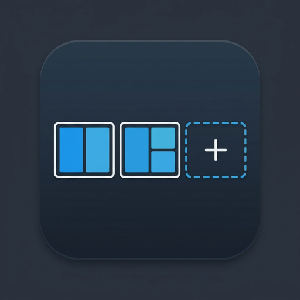

<p align="center">
  
</p>

# Dynamic Workspaces for KDE Plasma 6 (KWin)

**Version:** `1.0.0` · **Requires:** KDE Plasma 6 (KWin 6) · **License:** [MIT](LICENSE)

A KWin 6 script that brings **GNOME-style dynamic virtual desktops** to KDE Plasma 6, with full support for **Virtual Desktops Only on Primary** and **Shift+T / Shift+Drag Custom Tiling** on secondary monitors.

## Features

- **Always-available empty workspace**: Automatically keeps one empty virtual desktop at the end so you can always move a window to a new desktop.
- **Automatic cleanup**: Removes extra empty desktops once you switch away from them (never deletes your active desktop while you're on it, and never deletes the last remaining desktop).
- **Works with "Virtual Desktops Only on Primary"**: Windows pinned to all desktops (`onAllDesktops`) on secondary monitors do not count as occupying a virtual desktop.
- **Shift+T Custom Tiling Sync**: Automatically copies your custom tile layout (`rootTile`) from the active desktop to newly created or switched-to desktops on secondary monitors.
- **Secondary Monitor Window Placement**: Preserves secondary monitor windows' exact tile assignments (`window.tile`) and `frameGeometry` across desktop switches.

## Installation (KDE Plasma 6)

### Option 1: KDE Store (System Settings)

1. Open **System Settings → Window Management → KWin Scripts**.
2. Click **Get New...** and search for **Dynamic Workspaces**.
3. Install and enable **Dynamic Workspaces**.

### Option 2: From `.kwinscript` Package

Download `dynamicworkspaces.kwinscript` (from the repository or Releases), then either:
- Click **Install from File...** in **System Settings → Window Management → KWin Scripts**, or
- Install via CLI:

```bash
kpackagetool6 --type KWin/Script --install dynamicworkspaces.kwinscript
```

### Option 3: From Source

```bash
git clone https://github.com/alaurie/DynamicWorkspacesPlasma.git
cd DynamicWorkspacesPlasma
chmod +x install.sh
./install.sh
```

Then enable **Dynamic Workspaces** in:
**System Settings → Window Management → KWin Scripts**

Or enable via CLI:

```bash
kwriteconfig6 --file kwinrc --group Plugins --key dynamicworkspacesEnabled true
qdbus6 org.kde.KWin /KWin reconfigure
```

## Configuration

Open the configure button next to **Dynamic Workspaces** in **System Settings → Window Management → KWin Scripts**:

- **Always keep one empty virtual desktop at the end** (default: on)
- **Automatically remove empty virtual desktops** (default: on)
- **New desktop name prefix (optional)** (default: blank for KWin default)
- **Copy custom tile layout to new/switched desktops on secondary monitors** (default: on)
- **Also copy custom tile layout to new desktops on primary monitor** (default: off)
- **Preserve secondary monitor window tiles and geometry across desktops** (default: on)
- **Enable debug logging (`journalctl`)** (default: off)

## Packaging (`.kwinscript`)

To rebuild the `.kwinscript` package for distribution or KDE Store upload:

```bash
zip -r dynamicworkspaces.kwinscript metadata.json contents/
```

## Debugging

Enable debug logging in the script settings, then watch KWin logs:

```bash
journalctl -b -f | grep -i "dynamicworkspaces:"
```

## License

This project is licensed under the [MIT License](LICENSE).
